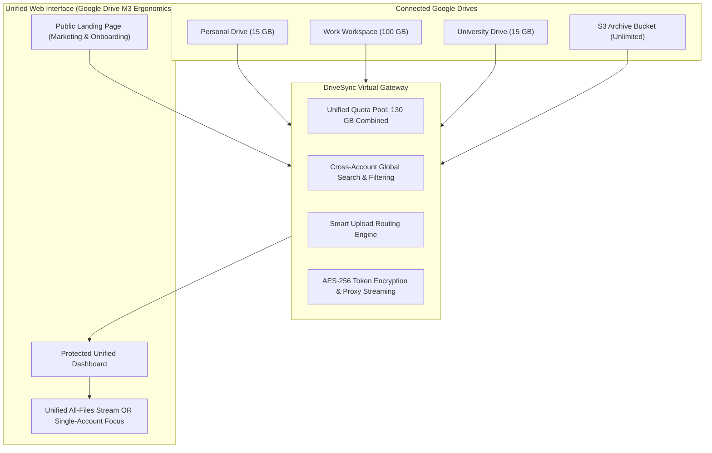
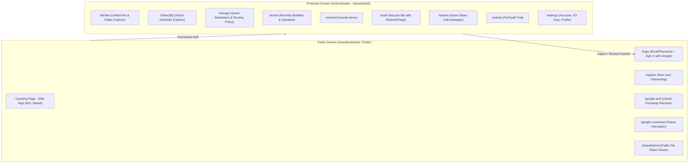

# DriveSync: Application Architecture & Technology Stack Specification

> **Target**: Comprehensive engineering blueprint for the DriveSync Next.js 16 frontend, detailing product capabilities, public vs. protected domain boundaries, technical stack rationale, and implementation architectures.

---

## 1. What DriveSync Does (Product Mission & Capabilities)

### 1.1 The Core Problem
Most modern internet users, freelancers, creators, students, and software engineers have **between 2 and 5 Google accounts**:
- A personal account (`firstname.lastname@gmail.com`) for life, photos, and personal documents.
- A college/alumni account (`student@university.edu`) with legacy files or educational storage.
- A work or client Google Workspace account (`name@company.com`).
- A side-business or project account (`contact@myproject.org`).

**The Pain Points**:
1. **Constant Profile Juggling**: Viewing files across accounts requires maintaining 3-4 Chrome profiles or repeatedly switching accounts in Google Drive, resulting in lost focus.
2. **Quota Fragmentation**: Account A is 98% full (14.7 GB / 15 GB) throwing *"Storage almost full"* warnings, while Account B has 12 GB completely empty. Google forces you to purchase Google One subscriptions on multiple accounts.
3. **No Cross-Account Search**: Searching for an invoice or legal contract requires manually searching in each account individually.
4. **Disjointed Uploads**: When uploading large files, users must manually guess which account has enough space left.

---

### 1.2 The DriveSync Solution
DriveSync is a **unified cloud filesystem and gateway** that connects multiple Google Drive accounts (plus S3 buckets) into a **single pane of glass**:



### Key Capabilities
- **Storage Pooling**: Aggregates $15\text{ GB} + 15\text{ GB} + 100\text{ GB} = 130\text{ GB}$ into a unified storage pool with segmented account visualizers.
- **Unified File Explorer**: Browse folders and files across all drives with visual account badges (`personal@...`, `work@...`).
- **Global Search with Filter Chips**: Instant search by file name, mime type (`PDF`, `Sheets`, `Video`), modified date, and target account.
- **Smart Upload Routing**: Drag-and-drop a file -> DriveSync automatically inspects all accounts and routes the upload to the drive with the most available space (or custom priority/round-robin).
- **In-App Streaming Media Previews**: High-performance video streaming (Plyr), audio player, PDF viewer, and image gallery without downloading files.
- **Bi-Directional File Synchronization**: Renaming a file in DriveSync updates the name directly in Google Drive via official APIs.
- **Public Share Links**: Generate secure, public download and preview links for any file with expiration dates.

---

## 2. Public Domain vs. Protected Domain Architecture

The application is cleanly divided into two architectural domains:



---

### 2.1 The Public Domain

#### 1. Marketing Landing Page (`/`)
- **Objective**: Convince visitors within 5 seconds of the multi-account aggregation concept and drive them to *"Get Started with Google"* in 1 click.
- **Structure**:
  - **Hero Section**:
    - Headline: *"All your Google Drives. One unified workspace."*
    - Subtitle: *"Stop switching profiles. Connect multiple Google accounts, pool your free storage, search across all drives, and upload with smart auto-routing."*
    - Primary CTA: Large *"Continue with Google"* button + secondary *"View Live Interactive Demo"*.
    - **Interactive Storage Pool Widget**: Visitors can drag a slider to simulate combining 2, 3, or 5 Google accounts and watch their pooled capacity grow in real-time.
  - **Feature Bento Grid**:
    - *Single Pane of Glass*: Screenshot comparison of scattered tabs vs. unified DriveSync explorer.
    - *Smart Upload Routing*: Animation showing a 2 GB file automatically routing to the drive with 12 GB free instead of the one with 500 MB left.
    - *Google Drive Material 3 Familiarity*: Highlighting zero learning curve.
    - *Enterprise-Grade Security*: Bank-grade AES-256 token encryption at rest, official Google OAuth verification, no file training, no third-party data scraping.
  - **Comparison Matrix**: DriveSync vs Native Google Drive vs Dropbox vs Box.
  - **FAQ Section**: Common questions (e.g. *"Is my data safe?"*, *"Does DriveSync read my files?"*, *"Can I disconnect anytime?"*).
  - **Footer**: Links to Privacy Policy, Terms of Service, GitHub repository, and status page.

#### 2. Authentication Pages (`/login` & `/register`)
- Clean, focused card centered on the screen.
- Prominent **"Continue with Google"** button triggering `GET /auth/google/url`.
- Traditional Email + Password fields with real-time validation (Zod + React Hook Form).
- Link to switch between Sign In and Sign Up.

#### 3. OAuth Handshake Routes
- **`/google-auth?token=...`**:
  - Receiver route when a user completes initial login with Google.
  - Automatically calls `POST /auth/google/exchange` with the token, stores the JWT access token in the auth store, and redirects to `/all-files`.
- **`/google-connected?status=success`**:
  - Non-blocking popup receiver route when connecting additional Google accounts.
  - Emits `window.opener.postMessage({ type: 'GOOGLE_CONNECTED', status: 'success' }, window.location.origin)`.
  - Closes the popup window automatically, allowing the dashboard to refresh connected accounts instantly.

#### 4. Public File Share Viewer (`/share/[token]`)
- Fast, unauthenticated landing page for recipients of shared file links (`GET /public/files/:token`).
- In-browser preview (streaming video, audio, PDF, or image) with a high-contrast **"Download File"** button.

---

### 2.2 The Protected Domain (`/(dashboard)`)

- Protected by Next.js middleware and client auth state verification.
- **Empty State (0 Accounts Connected)**:
  - If a newly registered user logs in with email/password and has not yet connected a Google account, the dashboard displays an engaging onboarding card:
    - *"Connect your first Google Drive to unlock your unified workspace."*
    - Prominent **"+ Connect Google Drive"** button.
- **Active Workspace Layout**:
  - **Top App Bar**: Search in DriveSync pill, Filter Chips bar, Health monitor, Theme toggle, Account Avatar.
  - **Left Navigation Drawer**: The "+ New" button, collapsible folder tree, Connected Accounts status list, Segmented Storage Pool meter.
  - **Main Stage**: Breadcrumbs, View mode switchers (Grid/List), Sort dropdown, Signature Folder cards, File thumbnail cards / dense table rows.
  - **Right Info & Activity Drawer**: File preview, file properties, sharing list, and audit trail.
  - **Floating Upload Tray**: Bottom-right floating card displaying transfer progress, speeds, and target drive routing.

---

## 3. Technology Stack Evaluation: "Best of the Best"

To deliver an interface with **Google Drive-grade responsiveness, 60fps scrolling, zero layout shifts, and bulletproof reliability**, we selected the following best-in-class technologies:

```
┌─────────────────────────────────────────────────────────────────────────────────────────┐
│ NEXT.JS 16 APP ROUTER + REACT 19 (RSC, Actions, Transitions, Compiler)                   │
├────────────────────────────┬─────────────────────────────┬──────────────────────────────┤
│ CLIENT STATE MANAGEMENT    │ STYLING & DESIGN TOKENS     │ UI ACCESSIBLE PRIMITIVES     │
│ Zustand 5 + Immer          │ Tailwind CSS v4             │ Radix UI / shadcn/ui         │
│ (Lightweight, no re-render)│ (Zero-runtime, Turbopack)   │ (WAI-ARIA Dialogs, Menus)    │
├────────────────────────────┼─────────────────────────────┼──────────────────────────────┤
│ DATA FETCHING & CACHING    │ LARGE DATASET VIRTUALIZATION│ DRAG & DROP PIPELINE         │
│ TanStack React Query v5    │ TanStack Virtual v3         │ @dnd-kit/core & utilities    │
│ (Stale-while-revalidate)   │ (10,000+ files at 60fps)    │ (Accessible file moving)     │
├────────────────────────────┼─────────────────────────────┼──────────────────────────────┤
│ MEDIA PREVIEW ENGINE       │ UPLOAD COORDINATOR          │ ICONS & NOTIFICATIONS        │
│ Plyr (HLS/MP4) + PDF.js    │ Resumable Chunk Controller  │ Lucide React + Sonner Toasts │
└────────────────────────────┴─────────────────────────────┴──────────────────────────────┘
```

### Detailed Rationale for Each Decision

| Layer | Chosen Technology | Why it's the "Best of the Best" | Alternatives Rejected & Why |
| :--- | :--- | :--- | :--- |
| **Framework** | **Next.js 16 (App Router) + React 19** | **React Server Components (RSC)** allow the marketing landing page to render with 100/100 Lighthouse performance and zero client JS. React 19's `useTransition` and `useOptimistic` provide instantaneous feedback when renaming or moving files. | Vite / CRA (no SSR/SEO for landing, manual routing), Remix (slower compiler compared to Next Turbopack). |
| **Styling** | **Tailwind CSS v4** | Pure CSS variable mapping (`@theme inline`) without heavy runtime JS. Native Turbopack compilation is 10x faster. Enables instant Light/Dark mode transitions matching Google Drive M3 tokens without flash of unstyled content (FOUC). | CSS Modules (verbose, slow to author), Styled-Components (runtime JS overhead, incompatible with RSC). |
| **Client State** | **Zustand 5** | Weighs only 1.2 KB. Does not trigger unnecessary component re-renders unlike React Context. Supports fine-grained selectors (`useShallow`). Manages active selection, upload tray state, and view preferences seamlessly. | Redux Toolkit (unnecessary boilerplate for client UI state), React Context (triggers cascading re-renders across the whole file tree). |
| **Server State & Cache** | **TanStack Query v5 (React Query)** | Industry standard for remote API caching, automatic background refetching, query invalidation on mutation (upload, rename, delete), and optimistic UI synchronization. | SWR (fewer features, lacks granular mutation controls), manual `useEffect` fetching (race conditions, boilerplate). |
| **UI Primitives** | **Radix UI (shadcn/ui)** | Headless, completely accessible (WAI-ARIA compliant). Gives us Google Drive's exact context menus (right-click on files), modal dialogs, tooltips, popovers, and dropdowns without writing focus-trapping logic from scratch. | Material-UI (heavy, opinionated, hard to customize), Headless UI (fewer components, slower updates). |
| **Virtualization** | **TanStack Virtual v3** | When users have 5,000 to 20,000 files across 4 Google accounts, rendering all DOM nodes crashes mobile browsers and lags desktops. TanStack Virtual renders *only* the 20-30 rows in the viewport, ensuring 60fps smooth scrolling. | No virtualization (lags with >500 items), React-window (older API, less flexible for variable height cards). |
| **Drag & Drop** | **`@dnd-kit`** | High-performance HTML5 drag-and-drop with pointer sensors, collision detection algorithms, and full keyboard accessibility for dropping files into folders. | React DnD (older, heavier, complex setup), native dragover only (poor cross-browser mobile support). |
| **Icons** | **Lucide React** | Consistent, modern icon set with clean SVG paths matching Google Workspace iconography (Folder, Search, Cloud, Star, Trash, Settings, Shield, Chevron). | FontAwesome (dated aesthetic, heavy), React Icons (bloated bundle size). |
| **Notifications** | **Sonner** | Sleek, stackable toast notifications for action confirmations (*"File moved to Projects"*, *"3 items uploaded to personal@gmail.com"*). | React-Toastify (dated look, heavier footprint). |
| **Media Player** | **Plyr** | Lightweight, accessible, fully themeable HTML5 video/audio player supporting streaming playback with custom controls and keyboard shortcuts. | Video.js (extremely heavy, complex styling). |

---

## 4. Frontend Application Architecture (`frontend/src/`)

```
frontend/src/
├── app/
│   │   # === PUBLIC DOMAIN ===
│   ├── page.tsx                       # Public Landing Page (Marketing, Hero, Bento, Demo)
│   ├── (auth)/
│   │   ├── login/page.tsx             # Sign In (Google OAuth + Email/Password)
│   │   └── register/page.tsx          # Sign Up (Create account)
│   ├── google-auth/page.tsx           # Initial Google sign-in handoff receiver
│   ├── google-connected/page.tsx      # Popup callback receiver (postMessage & close)
│   ├── share/[token]/page.tsx         # Public file share viewer
│   │
│   │   # === PROTECTED DOMAIN ===
│   └── (dashboard)/
│       ├── layout.tsx                 # Protected Shell: Topbar, Sidebar, UploadTray, InfoDrawer
│       ├── all-files/page.tsx         # Unified file explorer (Grid/List + Filter Chips)
│       ├── folder/[id]/page.tsx       # Subfolder view with recursive breadcrumbs
│       ├── storage/page.tsx           # Quota breakdown, account status, routing policy
│       ├── recent/page.tsx            # Recently modified / uploaded files
│       ├── starred/page.tsx           # Favorite starred files
│       ├── trash/page.tsx             # Recycle bin with restore and purge actions
│       ├── shared/page.tsx            # Active shared links & permissions manager
│       ├── activity/page.tsx          # Audit history timeline
│       └── settings/page.tsx          # Connected Google accounts, S3 configs, profile
│
├── components/
│   ├── landing/                       # Landing Page Components
│   │   ├── hero-section.tsx           # Headline, CTAs, interactive storage slider
│   │   ├── bento-features.tsx         # Visual cards highlighting multi-account capabilities
│   │   ├── interactive-demo.tsx       # Interactive mini-explorer simulating unified search
│   │   ├── comparison-table.tsx       # DriveSync vs Google Drive vs Dropbox
│   │   └── landing-footer.tsx
│   ├── layout/                        # Dashboard Shell Components
│   │   ├── topbar.tsx                 # Search in DriveSync pill, Filter chips, User menu
│   │   ├── sidebar.tsx                # "+ New" button, Nav tree, Account list, Storage bar
│   │   ├── filter-chips-bar.tsx       # Account, Type, Modified, Owner dropdown chips
│   │   └── info-drawer.tsx            # Right-side Details & Activity tabs
│   ├── folders/
│   │   ├── folder-card.tsx            # Signature folder card with peeking paper note
│   │   ├── folder-grid.tsx            # Responsive grid of folder cards
│   │   └── folder-tree.tsx            # Collapsible recursive sidebar tree
│   ├── files/
│   │   ├── file-card.tsx              # Grid file thumbnail card with mime-type icon
│   │   ├── file-table.tsx             # Virtualized dense table view
│   │   ├── file-preview-modal.tsx     # In-app viewer for Video (Plyr), Audio, PDF, Images
│   │   ├── file-context-menu.tsx      # Radix right-click contextual actions
│   │   └── selection-action-bar.tsx   # Floating pill bar for batch operations
│   ├── uploads/
│   │   ├── upload-dropzone.tsx        # Drag-and-drop overlay with visual target
│   │   └── upload-tray.tsx            # Bottom-right floating card with routing indicator
│   ├── accounts/
│   │   ├── account-badge.tsx          # Compact pill on files showing source drive
│   │   ├── multi-account-storage-bar.tsx # Segmented storage visualizer
│   │   └── connected-accounts-modal.tsx  # Add, sync, or disconnect Google accounts
│   └── ui/                            # Radix Primitives (Button, Dialog, Popover, Menu, Tooltip)
│
├── lib/
│   ├── api.ts                         # Axios client with automatic 401 token refresh
│   ├── query-client.ts                # TanStack Query client & cache configuration
│   ├── utils.ts                       # Formatters (bytes, dates, human sizes, mime helpers)
│   └── types.ts                       # TypeScript interfaces mirroring backend DTOs
│
└── stores/
    ├── auth-store.ts                  # User session, JWT tokens, login/logout
    ├── account-store.ts               # Connected accounts list, active account filter, storage summary
    ├── ui-store.ts                    # View mode (grid/list), sidebar state, info drawer open/close
    ├── selection-store.ts             # Active multi-selected file/folder IDs
    └── upload-store.ts                # Active upload queue, chunk coordinator, progress tracking
```

---

## 5. End-to-End User Journeys (UX Walkthroughs)

### 5.1 Journey A: First-Time User from Landing to Connected Drives
1. **Discovery**: User visits `drivesync.io` (Public Landing Page). They interact with the live storage slider, seeing how their 3 accounts will pool into a 45 GB workspace.
2. **One-Click Sign-In**: User clicks **"Continue with Google"**.
3. **Google Consent**: Google's OAuth consent screen displays requested permissions (`drive.file`, `userinfo.email`).
4. **Handoff & Redirect**: Google redirects to backend callback -> backend redirects to `/google-auth?token=xyz` -> frontend exchanges token and stores JWT session -> redirects to `/all-files`.
5. **Dashboard Onboarding**: The primary Google Drive is already connected. The storage meter displays `15 GB`.
6. **Connecting Account #2**:
   - In the sidebar under Connected Accounts, user clicks **"+ Connect Google Account"**.
   - A non-blocking popup opens Google OAuth.
   - User chooses their second email (`work@company.com`).
   - The popup closes; `window.postMessage` fires.
   - The dashboard dynamically refreshes: Storage meter jumps to `30 GB` pooled capacity! Both accounts are listed with green status indicators.

---

### 5.2 Journey B: Day-to-Day Multi-Account File Browsing & Search
1. **Unified View**: By default, `/all-files` displays files across both accounts. Every file has an `AccountBadge` (e.g. 🔵 `personal@gmail.com` or 🟢 `work@company.com`).
2. **Instant Search**: User types `"Q3 Report"` into the top search bar. DriveSync searches both Google Drives simultaneously and displays results in <100ms.
3. **Account Filter Chip**: User clicks the `[ Account: All Drives ▾ ]` chip and selects `work@company.com`. The file grid instantly filters to only work files.
4. **Preview**: User clicks a 400 MB video file. The in-app Plyr streaming modal opens instantly without downloading the file locally.
5. **Rename**: User right-clicks the file -> clicks **Rename** -> enters new title. The name updates immediately on the screen (optimistic UI) and synchronizes to Google Drive in the background.

---

### 5.3 Journey C: Drag-and-Drop Upload with Smart Auto-Routing
1. User drags `presentation_deck.pdf` (85 MB) and drops it anywhere onto the window.
2. An elegant upload dropzone activates with dashed blue lines and a subtle hover tint.
3. The file is dropped. The **Floating Upload Tray** slides up in the bottom-right corner.
4. DriveSync checks the active routing policy (`most_available`). Account A has 1.2 GB free, while Account B has 8.5 GB free.
5. The tray displays:  
   `Destination: 🟢 work@company.com (Most available space: 8.5 GB)`
6. The file uploads via chunked streams. Upon completion, a green checkmark appears and the file animates into the file grid.

---

## 6. Implementation Phasing & Milestones

| Phase | Focus Area | Deliverables |
| :---: | :--- | :--- |
| **Phase 1** | **Foundations & Dependencies** | Install core packages (`zustand`, `@tanstack/react-query`, `@radix-ui/*`, `lucide-react`, `sonner`, `plyr`, `axios`). Configure Tailwind v4 tokens in `globals.css` matching Google Drive M3 tokens. Setup `lib/api.ts` with silent 401 refresh. |
| **Phase 2** | **Public Landing Page (`/`)** | Build Hero section with interactive storage pool calculator, Bento feature grid, Google Drive M3 comparison, responsive navbar with CTAs, and footer. |
| **Phase 3** | **Authentication & OAuth Handshake** | Build `/login`, `/register`, `/google-auth` token exchanger, and `/google-connected` popup receiver. Connect to backend `/auth` routes. |
| **Phase 4** | **Dashboard Shell & Layout** | Implement Topbar (search pill, health indicator, theme toggle), Sidebar ("+ New" button, navigation tree, account list, segmented storage bar), and Filter Chips bar. |
| **Phase 5** | **Multi-Account Connected Drives** | Implement `ConnectedAccountsModal` (add Google Drive, sync quota, disconnect), `AccountBadge`, and `MultiAccountStorageBar`. |
| **Phase 6** | **Files & Folders Engine** | Signature Folder Card with peeking paper sheet, responsive Folder Grid, File Preview Card (Grid), Virtualized File Table (List), and Radix Context Menu. |
| **Phase 7** | **Uploads & Smart Routing** | Drag-and-Drop dropzone overlay, Floating Upload Tray with progress coordinator, destination indicator, and policy selector. |
| **Phase 8** | **Media Previews & Sharing** | Plyr video streaming modal, PDF viewer, image lightbox, Public Share link modal, and `/share/[token]` public viewer page. |
| **Phase 9** | **Refinement & Polish** | Full responsive verification across 390px, 1024px, and 1440px in Light and Dark modes. Zero TypeScript warnings, clean builds. |

