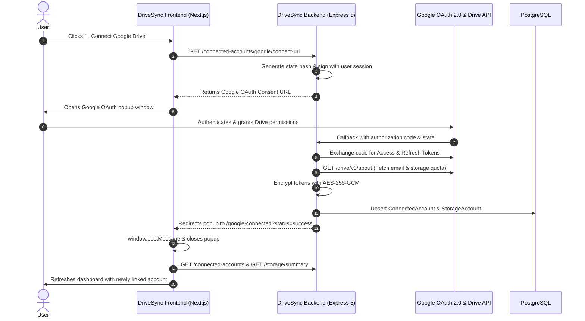
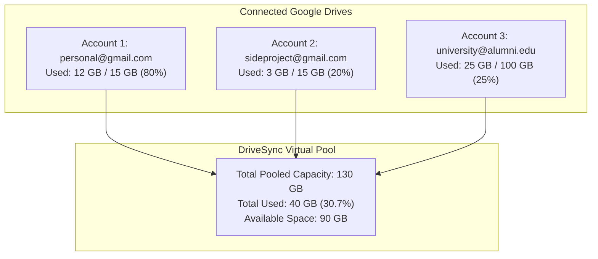
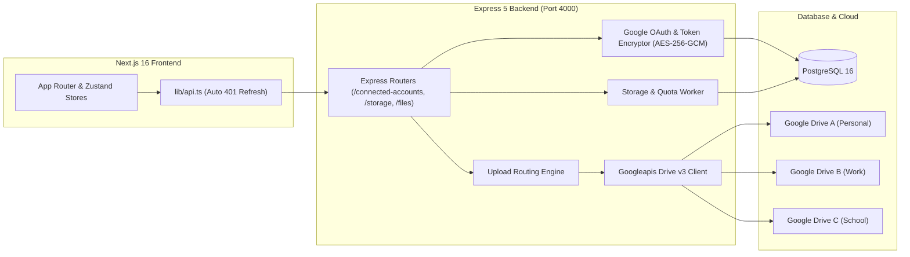
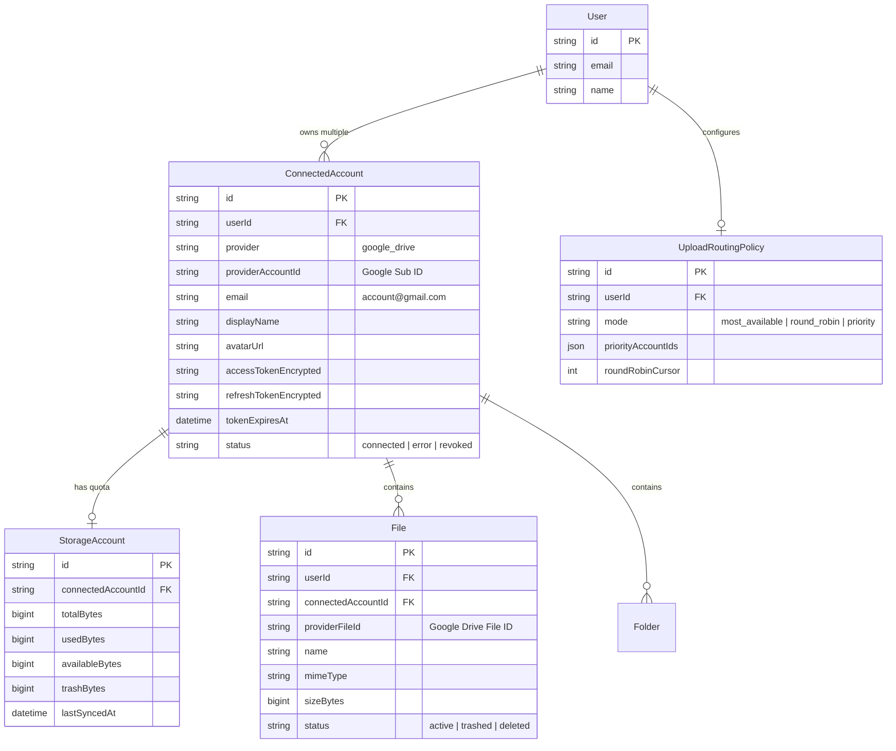

# DriveSync Multi-Account Google Drive Management

## 1. Executive Summary & Vision

**DriveSync** solves cloud storage fragmentation. Most power users, freelancers, students, and teams maintain between 2 and 5+ Google accounts (personal Gmail, university Workspace, corporate email, client-specific accounts). Managing files across these accounts requires switching browser profiles, constantly logging in and out, and leaving free storage quotas underutilized in one account while running out of space in another.

DriveSync aggregates **multiple Google Drive accounts into a unified cloud filesystem** managed from a single dashboard:
- **Combined Storage Pool**: Merge multiple free 15GB tiers (or paid tiers) into one combined quota (e.g., 15GB + 15GB + 100GB = 130GB total).
- **Single Pane of Glass**: Browse, search, preview, and organize files across all accounts simultaneously.
- **Smart Upload Routing**: Automatically route incoming uploads to the account with the most free space, or assign uploads according to custom policies.
- **Bi-directional Sync & Isolation**: Changes (such as renaming) sync back to Google Drive via official APIs while keeping credentials strictly isolated and encrypted at rest.

---

## 2. Core User Workflows & UX

### 2.1 Connecting Multiple Google Accounts



1. **Initial Account**: During first-time onboarding or registration via Google, the user's primary account is connected as Account #1.
2. **Subsequent Accounts**:
   - In the sidebar or settings drawer, the user clicks **"+ Connect Account"** -> **"Google Drive"**.
   - A non-blocking popup window opens to Google's standard OAuth consent screen.
   - The user selects any other Google account (e.g. `work@company.com`).
   - The backend exchanges the OAuth authorization code, encrypts the credentials, records initial quota metrics, and closes the popup.
   - The frontend receives a `GOOGLE_CONNECTED` message via `window.postMessage`, instantly updating the accounts list and storage metrics without a page reload.

---

### 2.2 Unified vs Account-Filtered Browsing

Users can switch viewing perspectives with a single click:

| View Mode | What the User Sees | Best Used For |
| :--- | :--- | :--- |
| **Unified Workspace** *(Default)* | All files and folders across all connected Google accounts displayed together in a virtual directory tree. Each item displays an **Account Badge** (e.g., `personal@gmail.com`). | Finding any file instantly, searching across your entire digital life, and monitoring combined storage. |
| **Filtered Account View** | Selecting a specific account pill filters the file grid, recent uploads, and trash to show only files belonging to that chosen Google Drive. | Auditing a specific work drive, preparing client deliverables, or checking individual storage usage. |

---

### 2.3 Aggregated Storage Pool & Per-Account Quotas

DriveSync turns fragmented accounts into a virtual storage pool:



- **Aggregated Meter**: Displays total combined capacity, total used bytes, and total free space.
- **Segmented Visualizer**: A multi-color segmented progress bar where each segment corresponds to a specific connected account.
- **Quota Warnings**: Visual indicators flag accounts nearing 90%+ capacity before Google blocks uploads.

---

### 2.4 Smart Upload Routing

When a user drops files into DriveSync, how does the system decide which Google Drive receives the files?

DriveSync supports 4 configurable routing policies via `UploadRoutingPolicy`:

```mermaid
flowchart TD
    Upload[User drops file: presentation.mp4 - 1.2 GB] --> CheckPolicy{Active Policy}

    CheckPolicy -->|most_available (Default)| QuerySpace[Inspect availableBytes across all active accounts]
    QuerySpace --> PickMax[Select account with largest free space]

    CheckPolicy -->|priority| QueryPriority[Check priorityAccountIds list in order]
    QueryPriority --> PickPriority[Select highest priority account with sufficient space]

    CheckPolicy -->|round_robin| QueryCursor[Inspect roundRobinCursor index]
    QueryCursor --> PickNext[Select next active account in cycle]

    CheckPolicy -->|manual| UserPick[User explicitly selected account in Upload Tray]
    UserPick --> PickManual[Target selected account]

    PickMax --> StreamUpload[Stream upload directly to Google Drive via backend proxy]
    PickPriority --> StreamUpload
    PickNext --> StreamUpload
    PickManual --> StreamUpload
```

1. **`most_available` (Default & Recommended)**: Automatically picks the Google Drive account with the most remaining free bytes. If Account A has 2 GB free and Account B has 12 GB free, uploads automatically go to Account B.
2. **`priority`**: Attempts to fill Account 1 first; once Account 1 reaches a threshold or runs out of room, overflow automatically routes to Account 2.
3. **`round_robin`**: Distributes files sequentially across accounts to balance usage evenly.
4. **`manual`**: The user can toggle an account selector in the floating upload drawer to force a specific file into a specific Google Drive.

---

## 3. System Architecture & Multi-Tenancy



### 3.1 Security & Token Isolation
- **AES-256-GCM Encryption**: All Google OAuth `accessToken` and `refreshToken` strings are encrypted before being written to PostgreSQL. Even database dumps cannot expose credentials.
- **Zero Frontend Leakage**: The frontend never receives raw Google OAuth tokens. It only communicates with the backend via DriveSync JWT session tokens (`Authorization: Bearer <token>`).
- **Automatic Silent Refresh**: When a request to Google Drive API fails due to an expired access token, the backend automatically uses the encrypted refresh token to obtain a fresh access token from Google, updates the database, and retries the operation transparently.

---

## 4. PostgreSQL Data Model Reference

The following relational entities in `backend/prisma/schema.prisma` power the multi-account capabilities:



---

## 5. API Endpoints for Multi-Account Operations

| Endpoint | Method | Purpose | Key Payload / Response |
| :--- | :---: | :--- | :--- |
| `/connected-accounts` | `GET` | List all connected accounts with quotas | `[{ id, email, displayName, avatarUrl, status, storageAccount }]` |
| `/connected-accounts/google/connect-url` | `GET` | Generate Google OAuth link for adding an account | `{ url: "https://accounts.google.com/..." }` |
| `/connected-accounts/google/callback` | `GET` | OAuth return point; links account & triggers sync | Redirects to `/google-connected?status=success` |
| `/connected-accounts/:id/sync-quota` | `POST` | Force immediate quota refresh from Google | `{ quota: { totalBytes, usedBytes, availableBytes } }` |
| `/connected-accounts/:id` | `DELETE` | Disconnect a Google account | `{ status: "ok" }` |
| `/storage/summary` | `GET` | Aggregated storage across all accounts | `{ totalBytes, usedBytes, availableBytes, accounts: [...] }` |
| `/storage/routing-policy` | `GET` | View active upload routing policy | `{ policy: { mode, priorityAccountIds } }` |
| `/storage/routing-policy` | `PATCH` | Change routing strategy | Body: `{ mode: "most_available" \| "round_robin" \| "priority" }` |
| `/files?accountId=xyz` | `GET` | Query files filtered to a specific account | `{ files: [...] }` |
| `/files/upload` | `POST` | Upload file (auto-routes or accepts `targetAccountId`) | Multipart form data with file & optional `accountId` |

---

## 6. Frontend UI Components Specification

To deliver an intuitive multi-account experience adhering to the **DriveSync Design System** (`docs/DESIGN_SYSTEM.md`), the frontend implements the following dedicated components:

### 6.1 Account Badge (`AccountBadge.tsx`)
- Renders next to files and folders in unified view.
- Displays Google Drive favicon, user avatar/initials, and truncated email (e.g. `work@...`).
- Clickable: clicking the badge instantly filters the current view to that specific account.

### 6.2 Multi-Account Storage Bar (`MultiAccountStorageBar.tsx`)
- A segmented progress bar rendered in the sidebar and storage dashboard.
- Each connected account receives a distinctive, theme-compliant color token.
- Hovering over a segment displays a tooltip with account email, used bytes, and percentage of overall storage.
- Shows total pooled storage metric (e.g., `42.5 GB of 130 GB used`).

### 6.3 Connected Accounts Modal (`ConnectedAccountsModal.tsx`)
- Accessed from the sidebar user menu or settings.
- Displays each linked Google account with:
  - Account avatar and email address.
  - Connection health status (`Active`, `Needs Re-auth`, `Syncing`).
  - Storage progress meter specifically for that account.
  - **"Sync Now"** button (triggers `POST /connected-accounts/:id/sync-quota`).
  - **"Disconnect"** button with confirmation dialog.
- Prominent **"+ Connect another Google Drive"** button that opens the OAuth popup.

### 6.4 Upload Tray with Target Routing (`UploadTray.tsx`)
- Floating card docked at bottom-right during active uploads.
- Displays:
  - File name, progress percentage, transfer speed, and remaining time.
  - **Target Account Indicator**: Shows the chosen Google Drive destination (e.g., `Routing to: personal@gmail.com (Most space)`).
  - Ability to override destination before starting transfer.

### 6.5 Signature Folder Card with Account Indicator
- Adheres to DriveSync signature folder aesthetics (paper sheet peeking out with smooth lift on hover).
- Subtitle displays file count, total size, and the account badge of the drive hosting the folder.

---

## 7. Implementation Checklist for Frontend

- [x] **Backend Multi-Account Support**: Ready with PostgreSQL, AES encryption, and Express routes.
- [ ] **Auth Store & Account Store (`stores/accountStore.ts`)**: Zustand store managing list of connected accounts, active filter, and storage summary.
- [ ] **OAuth Popup Handler (`app/google-connected/page.tsx`)**: Lightweight redirect receiver that posts message to opener and closes.
- [ ] **Multi-Account Storage Bar**: Component showing aggregated and per-account usage in the sidebar.
- [ ] **Account Switcher / Filter Pills**: Header pills to toggle between "All Accounts" and individual drives.
- [ ] **File Grid & List Account Badges**: Displaying source drive on each file item.
- [ ] **Connected Accounts Management Modal**: Dialog to view, sync, and disconnect drives.
- [ ] **Upload Tray Destination Selector**: Visual indicator of upload routing destination.

